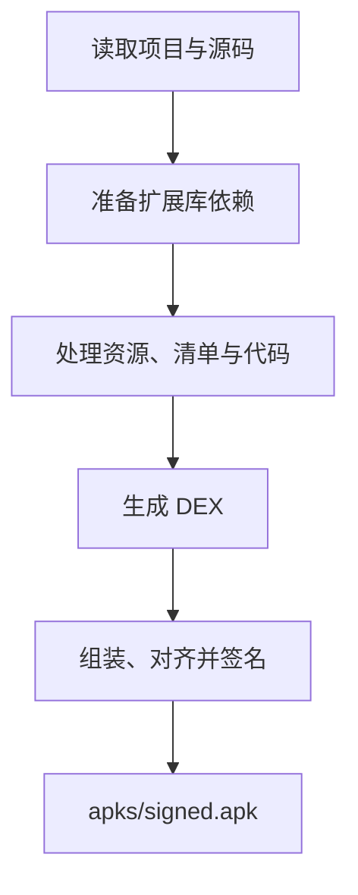

# Simple

基于谷歌 [Simple](https://code.google.com/archive/p/simple/) 进行中文化、功能扩展和 Android 兼容性改进，提供编译器与运行库源码、样例和测试。

> 普通用户和扩展库开发者请下载[完整 SDK](https://dwz.wsd.cx/es4a-sdk)。


## 目录

- `src/`：编译器与 Android 运行库源码。
- `SimpleCompiler.json`、`SimpleAndroidRuntime.json`、`icons/`：编译器与运行库清单及组件图标。
- `samples/`、`tests/`：样例与测试。
- `gradle/`、`scripts/`：构建配置和工具脚本；`gradle/resolver/` 为随编译器交付的依赖解析工程源码。
- `libs/`：编译器依赖。


## 构建

将 [SDK 仓库](https://gitee.com/es4a/sdk)与本仓库同级放置，按其自述准备工具。在 Windows 下，于本目录执行：

```powershell
.\scripts\build.bat
```

默认增量编译并运行 JVM 测试，可追加 Gradle 任务和参数，如 `clean build`、`test` 或 `--offline`。

编译器依赖自动准备到 `libs/`，其中的 JAR 不提交 Git。首次构建需要联网，后续复用缓存。

构建产物位于 `build/`，分发位于 `dist/`，测试报告位于 `reports/tests/`。

验证通过后执行：

```powershell
.\scripts\release.bat
```

将 `dist/windows/` 中的已有交付发布到同级 `sdk/simple/`，不重新构建。


## 应用编译流程



应用构建目录下，`apks/signed.apk` 为最终 APK，`android_debug.p12` 为调试签名证书。


## 相关链接

- [使用与开发文档](https://gitee.com/es4a/sdk/blob/main/docs/README.md)
- [开源仓库](https://gitee.com/es4a)
- [留言反馈](https://dwz.wsd.cx/wsd-ly)
